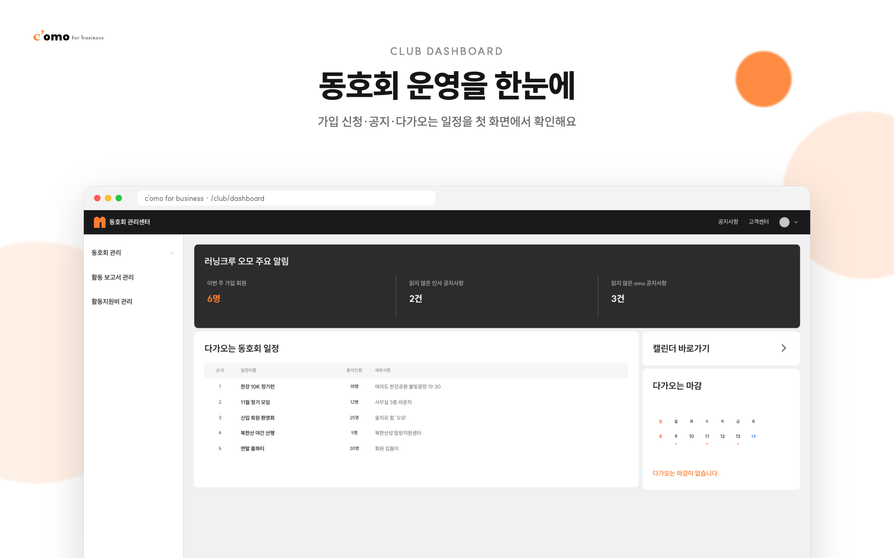
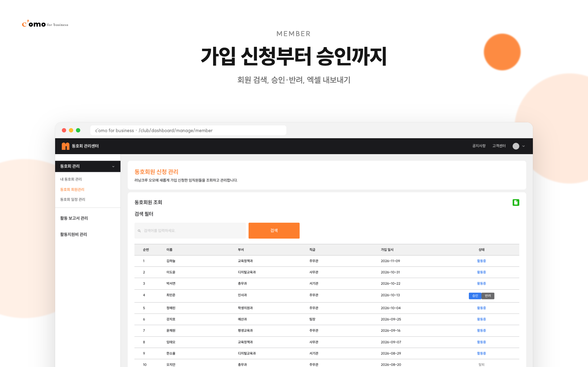
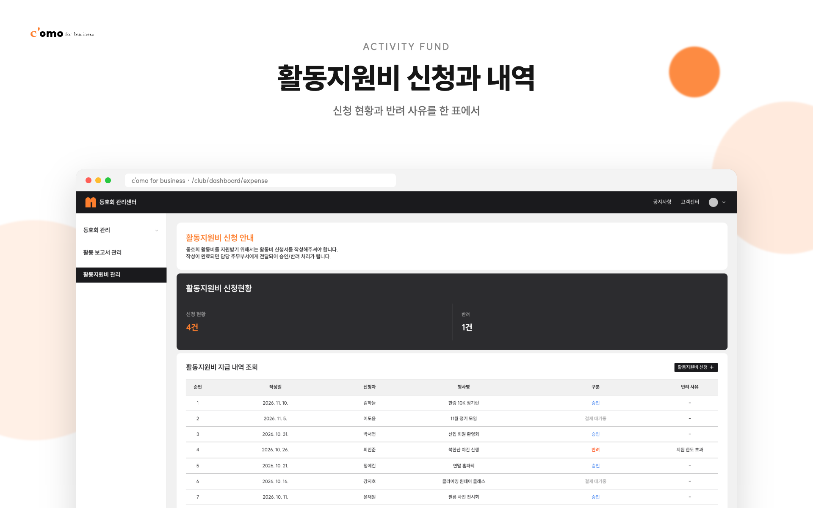
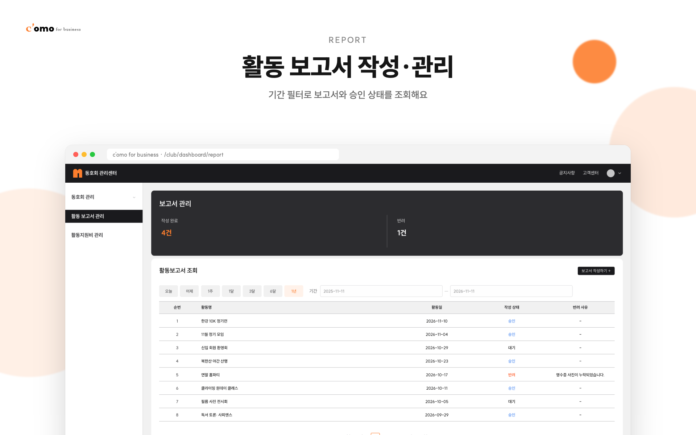
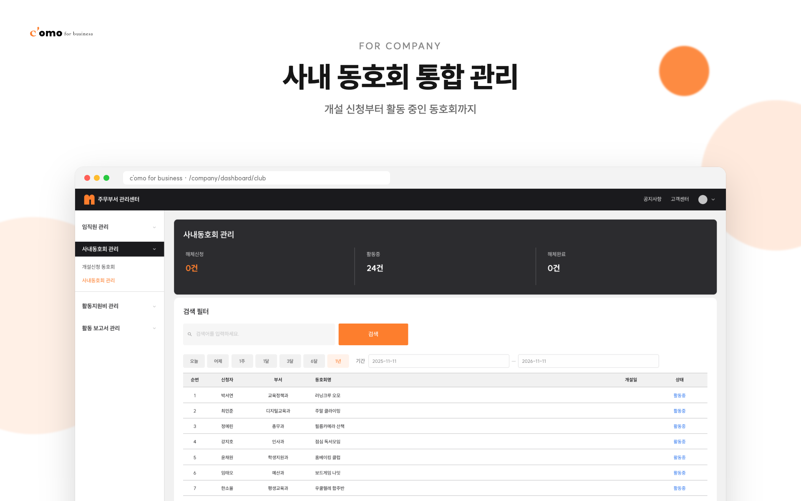
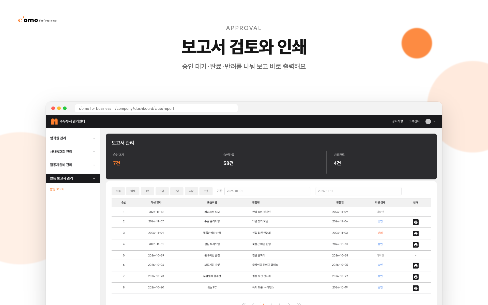
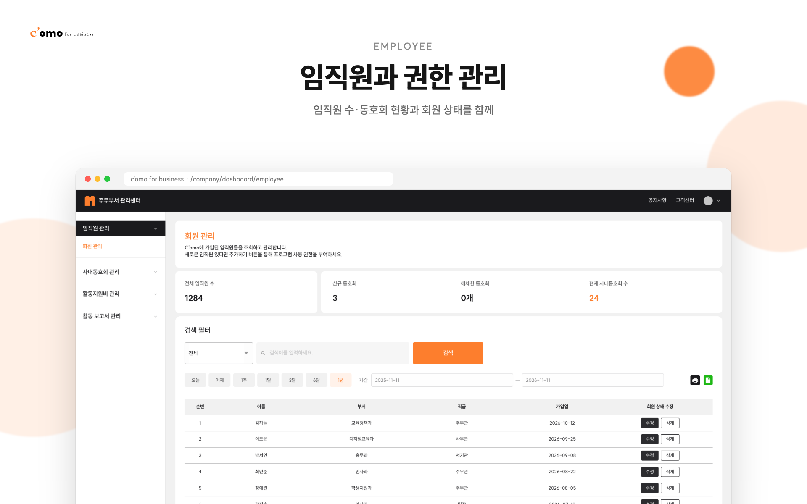
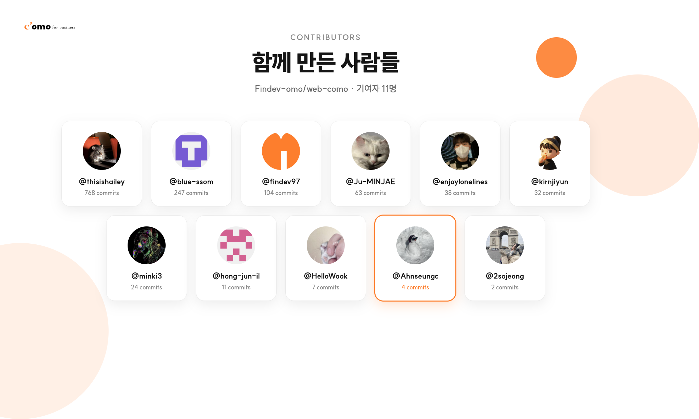

<div align="center">


### 사내 동호회 운영·관리 웹 관리센터

직장인 취미 복지 플랫폼 [C'omo(코모)](https://play.google.com/store/apps/details?id=com.findev.como&hl=ko)의 **웹 관리자 서비스**입니다.<br/>
동호회 운영진은 회원·일정·활동 보고서·지원비를 관리하고, 기업 담당자는 사내 동호회와 임직원을 한곳에서 관리합니다.

**서울시교육청 시범 도입**


</div>

> 이 레포는 팀 프로젝트 [Findev-omo/web-como](https://github.com/Findev-omo/web-como)를 히스토리 그대로 옮긴 포트폴리오용 사본입니다.<br/>
> 아래 화면은 실제 서버 대신 `mock/` 의 가상 데이터로 로컬 실행해 캡처했습니다. 인물·회사·동호회 이름은 모두 가상입니다.

## 화면

### 동호회 운영진






### 기업 담당자





## 주요 기능

| 대상 | 기능 |
| --- | --- |
| 동호회 운영진 | 대시보드(가입 신청·공지·다가오는 일정), 동호회 소개/모집 정보 편집, 회원 가입 승인·반려, 일정 등록·수정(네이버 지도 장소 검색), 활동 결과 보고서 작성, 활동지원비 신청·내역 조회, 공지·자료실, omo shop |
| 기업 담당자 | 임직원 관리·엑셀 내보내기, 사내 동호회 개설 승인·반려, 활동 보고서 승인/반려·인쇄(PDF), 활동지원비 승인, 사내 공지·문서 배포, 복지 포인트·구독 |
| 공통 | 역할(동호회/기업/관리자)별 미들웨어 라우팅, 동호회 개설 신청 퍼널(`/club-apply`) |

## 내가 맡은 부분

[@Ahnseungc](https://github.com/Ahnseungc) · 2025.04 – 2025.07, 동호회 운영진 대시보드 위주

- **동호회 일정 관리**: 일정 등록·수정·삭제, 등록 기간 설정, 장소 위도·경도 저장
- **활동 결과 보고서**: 작성 폼과 스키마 검증 메시지, 과거 날짜 선택 오류, 영수증 이미지 중복 업로드 문제 수정
- **폼 UX**: 제출 디바운스, 토스트 알림, `useAutoSave` 훅으로 작성 중 폼 자동 저장
- **공통 UI**: 페이지네이션 처음/끝 비활성화, 동호회 기본정보 읽기 전용 처리, 회원 목록 페이지네이션 수정

## 기술 스택

- **Framework**: Next.js 14 (App Router), React 18, TypeScript
- **State·Data**: TanStack Query, Zustand, React Hook Form + Zod
- **UI**: Tailwind CSS, Framer Motion, Chart.js, react-day-picker
- **문서·출력**: @react-pdf/renderer, react-to-print, xlsx
- **품질**: Storybook + Chromatic, ESLint, Prettier, Husky + lint-staged, commitlint, GitHub Actions(PR lint)

## 폴더 구조

```
src
├── app            # 라우트 (club/ · company/ · login/ · club-apply/ · api/ 프록시)
├── components     # atoms → molecules → organisms, 도메인별(dashboard/club, dashboard/company …)
├── api            # 서버 액션·도메인 타입
├── hooks          # 공용 훅 (useAutoSave 등)
├── lib            # API 클라이언트, 쿠키, 상수, 스토어
└── middleware.ts  # 로그인·역할별 접근 제어
mock/              # 스크린샷용 목 API 서버
```

## 로컬 실행 (목 데이터)

```bash
npm ci
npm run mock
NEXT_PUBLIC_SERVER_URL=http://localhost:4010 npm run dev
```

로그인 화면에서 아무 아이디·비밀번호로 들어가면 동호회 운영진으로 로그인됩니다. 기업 담당자 화면은 `MOCK_ROLE=ROLE_MANAGER npm run mock` 으로 목 서버를 띄운 뒤 로그인합니다.

## 함께 만든 사람들


